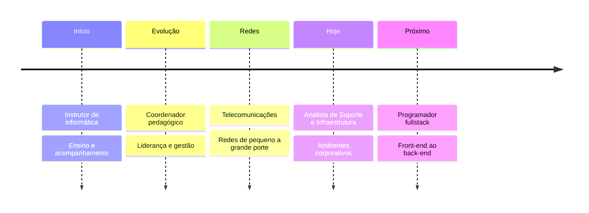

Analista de Suporte e Infraestrutura · em transição para **programador fullstack**

 

---

## 🗺️ Trajetória

Na área de TI desde **2014**. A linha segue a evolução, sem datas.

---

## 🎓 Formação

- Gestão de Tecnologia da Informação
- Pós-graduação em Governança de TI

---

## 🛠️ Tech stack

**Em aprendizado**

**Infraestrutura e redes**

**IDEs**

---

## 🚀 Objetivo

Evoluir para **programador fullstack**, unindo a experiência em infraestrutura e suporte ao desenvolvimento de aplicações web completas, do front-end ao back-end.

---

## 📊 GitHub

---

## 📫 Vamos conversar

Se quiser trocar ideia sobre desenvolvimento web, fullstack, infraestrutura ou suporte, me chama.

